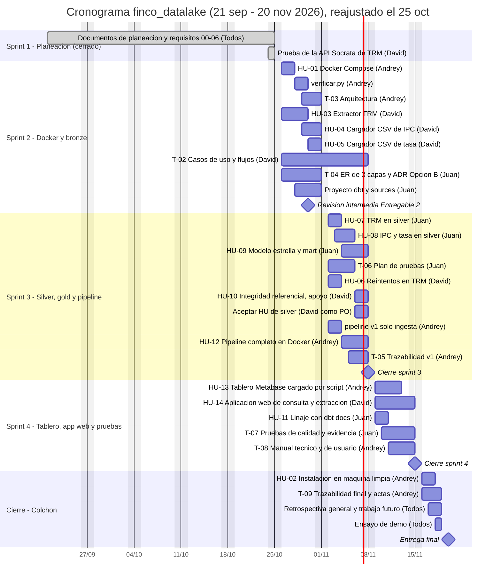

# 2. Planeación y cronograma

**Versión:** 1.1 — 25 de octubre de 2026
**Fuente de fechas y tareas:** `README.md` del repositorio (§4 fases, §12 checklist semanal, §13 ceremonias), **reajustadas el 25 de octubre de 2026** para cerrar en la fecha límite real: **20 de noviembre de 2026**.

> **Nota de estado.** El sprint 1 (21 sep – 25 oct) cerró sin repositorio funcional, entorno Docker ni código: solo existe la documentación de planeación y requisitos. El calendario original (4 sprints de 2 semanas, entrega final ~15 nov) ya no era alcanzable. Se comprimen los sprints 2 a 4 a una semana cada uno y se usa la semana 16 – 20 nov como colchón. **Los objetivos y el alcance no cambian**, salvo la historia nueva HU-14 (aplicación web de consulta y extracción), pedida por el PO el 25 de octubre.

---

## 1. Calendario por sprint

| Sprint | Fechas (2026) | Objetivo del sprint | Hito |
|---|---|---|---|
| 1 | 21 sep – 25 oct | Planeación y requisitos en borrador (documentos 00 a 06). **Cerrado sin entregables técnicos** | Acta del sprint 1 con el retraso como impedimento |
| 2 | 26 oct – 1 nov | Entregable 2 para la revisión intermedia (diseño UML, plan de pruebas y versionado, todo en el repositorio) y, en lo posible, Docker y bronze como avance del MVP | **Revisión intermedia: 30 oct (confirmada por el profesor)** |
| 3 | 2 – 8 nov | Silver y gold con pruebas dbt y pipeline completo en Docker | Cierre del sprint 3 |
| 4 | 9 – 15 nov | Tablero cargado con datos, aplicación web de consulta y extracción, pruebas ejecutadas y manuales | Cierre del sprint 4 |
| Cierre (colchón) | 16 – 20 nov | Instalación en máquina limpia, trazabilidad final, actas, retrospectiva y ensayo de demo | **Entrega final: 20 nov** |

> La revisión intermedia es el 30 de octubre y evalúa el Entregable 2 (análisis y diseño UML). El sprint 2 se reorienta a ese entregable.

## 2. Diagrama de Gantt

## 3. Fases del ciclo de vida y sprints

| Fase | Sprint(s) | Responsable principal | Evidencia | Criterio de salida |
|---|---|---|---|---|
| 1. Planeación | 1 | Todos | Documentos 00 a 06, roles, calendario, GitHub Projects, acta del sprint 1 | Backlog con épicas y tablero visible para los 3 |
| 2. Requisitos | 1 – 2 | Todos (el PO prioriza) | Requisitos RF/RNF, HU con Gherkin, backlog priorizado | HU de los sprints 2 y 3 en estado "Ready" |
| 3. Análisis y diseño | 2 (ajustes en 3) | David: casos de uso · Juan: modelo de datos · Andrey: arquitectura | Casos de uso, flujos, arquitectura, ER, ADR | Diseño revisado por los 3 antes de iniciar silver |
| 4. Construcción | 2 – 4 | Cada uno su capa | Código en `main` vía PR | HU que cumplen la DoD |
| 5. Pruebas | 2 – 4 | Juan coordina | Plan de pruebas, casos y evidencia | Casos críticos ejecutados y documentados |
| 6. Despliegue | 4 y cierre | Andrey | `docker compose up -d` y `docker compose run --rm pipeline`, manual técnico | Instalación en máquina limpia aprobada (CP-INST-01) |
| 7. Cierre | Cierre | Todos | Manual de usuario, trazabilidad final, retrospectiva, trabajo futuro | Entrega final ensamblada y demo ensayada |

## 4. Ceremonias y seguimiento

| Ceremonia | Fecha | Duración | Responsable del acta |
|---|---|---|---|
| Review + retro sprint 1 / planning sprint 2 | 25 – 26 oct | 45 min | Andrey |
| Review + retro sprint 2 / planning sprint 3 | 1 – 2 nov | 45 min | Andrey |
| Review + retro sprint 3 / planning sprint 4 (coincide con el marcador de la revisión intermedia) | 8 – 9 nov | 45 min | Andrey |
| Review sprint 4 / planning del cierre | 15 – 16 nov | 45 min | Andrey |
| Review final + retrospectiva general | 19 – 20 nov | 60 min | Andrey |
| Daily asíncrona | Lunes, miércoles y viernes | Mensaje corto | Cada integrante |

**Tablero de seguimiento (GitHub Projects).**

- Columnas: Backlog → Ready → En progreso → En revisión → Hecho.
- Campos: Sprint (1-4 y Cierre), Épica (1-7), Responsable, Requisito (RF/RNF) y estimación.
- Etiquetas: `ingesta`, `dbt`, `infra`, `tablero`, `app`, `docs`, `bloqueado`.

## 5. Carga por integrante (puntos de historia)

Los puntos son una propuesta (ver `06-product-backlog.md`). HU-04 y HU-05 se reestimaron a la baja porque ahora cargan un CSV versionado en el repositorio. HU-14 es nueva.

| Integrante | Sprint 2 | Sprint 3 | Sprint 4 | Cierre | Total HU | Tareas de documentación (Épica 7) |
|---|---|---|---|---|---|---|
| David | 10 (HU-03, 04, 05) | 4 (HU-06, HU-10 de apoyo) | 8 (HU-14) | — | 22 | T-02 |
| Juan Esteban | — | 16 (HU-07, 08, 09) | 3 (HU-11) | — | 19 | T-04, T-06, T-07 |
| Andrey | 3 (HU-01) | 3 (HU-12) | 5 (HU-13) | 3 (HU-02) | 14 | T-03, T-05, T-08, T-09 |
| **Total** | **13** | **23** | **16** | **3** | **55** | |

**Lecturas del plan:**

- **Horas recomendadas: ~10 por semana por integrante** (~30 h/semana, unas 110 h entre el 26 oct y el 20 nov). Cálculo: 55 puntos a ~1,5 h por punto son ~80 h de construcción, y la documentación (T-02 a T-09, actas, manuales, pruebas con evidencia) suma ~30 h. Con 5 h por semana (~55 h) el plan no cabe. El equipo debe confirmar que puede dedicar ese tiempo.
- Con 10 h por semana los picos siguen altos: ~10 puntos de David en el sprint 2 y ~16 de Juan en el sprint 3 (unas 15 a 24 h para cada uno en una semana). Por eso el sprint 3 es el más riesgoso.
- HU-10 pasa de Juan a David como apoyo para aliviar el sprint 3; la acepta Andrey (nadie aprueba su propio trabajo).
- HU-11 pasa del sprint 3 al 4, y HU-06 del 2 al 3.
- Orden de recorte propuesto si el tiempo no alcanza (lo decide el PO): HU-14, HU-11, HU-06.

## 6. Riesgos de planeación

| Riesgo | Probabilidad | Impacto | Mitigación |
|---|---|---|---|
| **Capacidad insuficiente:** 55 puntos más documentación en ~110 h (10 h por persona por semana) | Alta | Alto | Confirmar que el equipo dedica ~10 h por semana; usar el orden de recorte; alcance congelado salvo HU-14 |
| Inicio tardío: el sprint 1 cerró sin entregables técnicos | Ocurrido | Alto | Calendario comprimido, colchón del 16 al 20 nov, acta del sprint 1 con el retraso |
| **Revisión intermedia el 30 oct con el diseño UML sin hacer** | Alta | Alto | Priorizar el Entregable 2 en los 3 días restantes; el código de bronze pasa a segundo plano |
| HU-14 (aplicación web) agregada tarde, con 8 puntos | Alta | Medio | Primera en el orden de recorte; depende de HU-09 |
| IPC y tasa de intervención solo por descarga manual de CSV | Media | Medio | CSV versionados en el repositorio (aceptado por el profesor); URL directa como mejora futura |
| PO también es desarrollador | Alta | Medio | Regla de aprobación: nadie acepta sus propias historias |
| Tablero de Metabase no reproducible en la máquina del evaluador | Alta | Alto | Script que lo crea por la API de Metabase al final del pipeline; validar con CP-INST-01 |
| Sin CI, alguien fusiona código que rompe el pipeline | Media | Medio | `verificar.py` obligatorio con evidencia en el PR y `main` protegida |
| Curva de aprendizaje de dbt | Media | Medio | Juan prepara el proyecto dbt y las fuentes en el sprint 2 |
| Desbalance de carga | Alta | Medio | Reparto de HU-10 y HU-06 descrito arriba |
