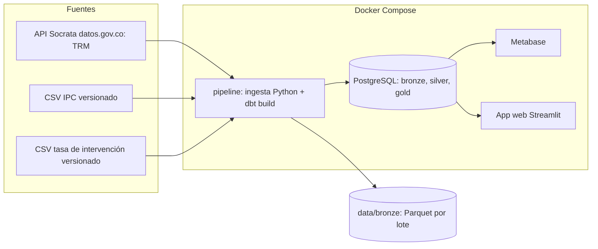

# Arquitectura y componentes (T-03)

Lakehouse híbrido: bronze se escribe como Parquet inmutable por lote (el lake, fuente de verdad) y se replica en PostgreSQL, donde dbt construye silver y gold (el house).

| Componente | Tecnología | Servicio Compose | Responsabilidad |
|---|---|---|---|
| Ingesta | Python (`ingesta/`) | `pipeline` | Extraer TRM, cargar CSV, escribir Parquet y `bronze.*_raw` |
| Transformación | dbt Core (`dbt/`) | `pipeline` | Construir silver y gold, ejecutar pruebas |
| Almacenamiento | PostgreSQL 16 | `postgres` | Esquemas `bronze`, `silver`, `gold` |
| Lake | Parquet en `data/bronze/` | volumen `./data` | Datos crudos inmutables por lote |
| Tablero | Metabase | `metabase` | HU-13, creado por script contra su API |
| Consulta y descarga | Streamlit (`app/`) | `app` (perfil `app`) | HU-14, lee gold |

Puertos y credenciales salen de `.env` (copia de `.env.example`).
