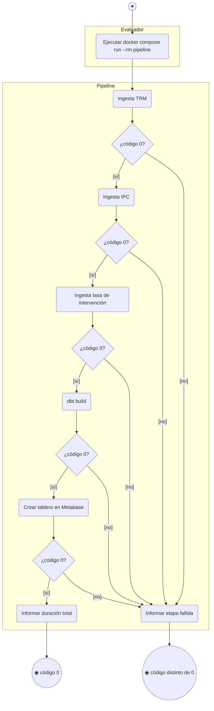
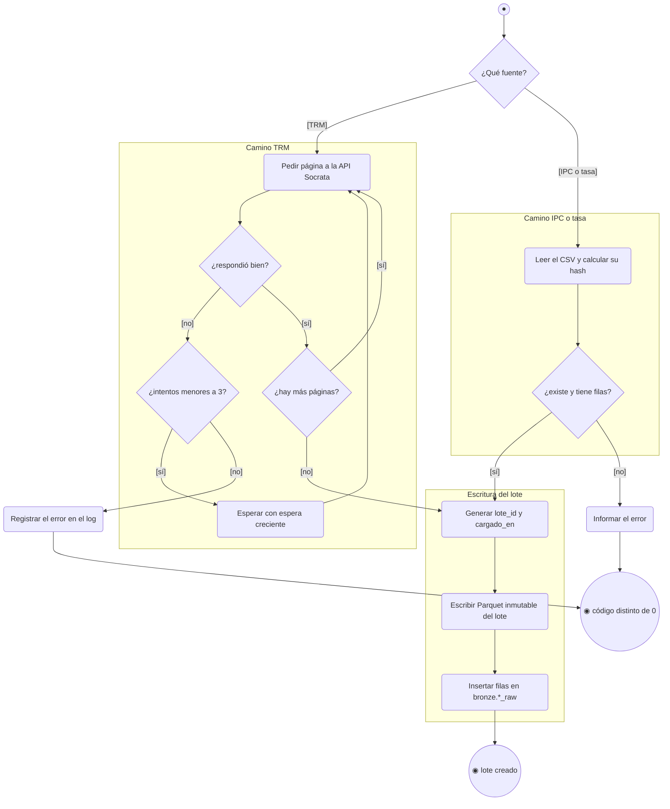
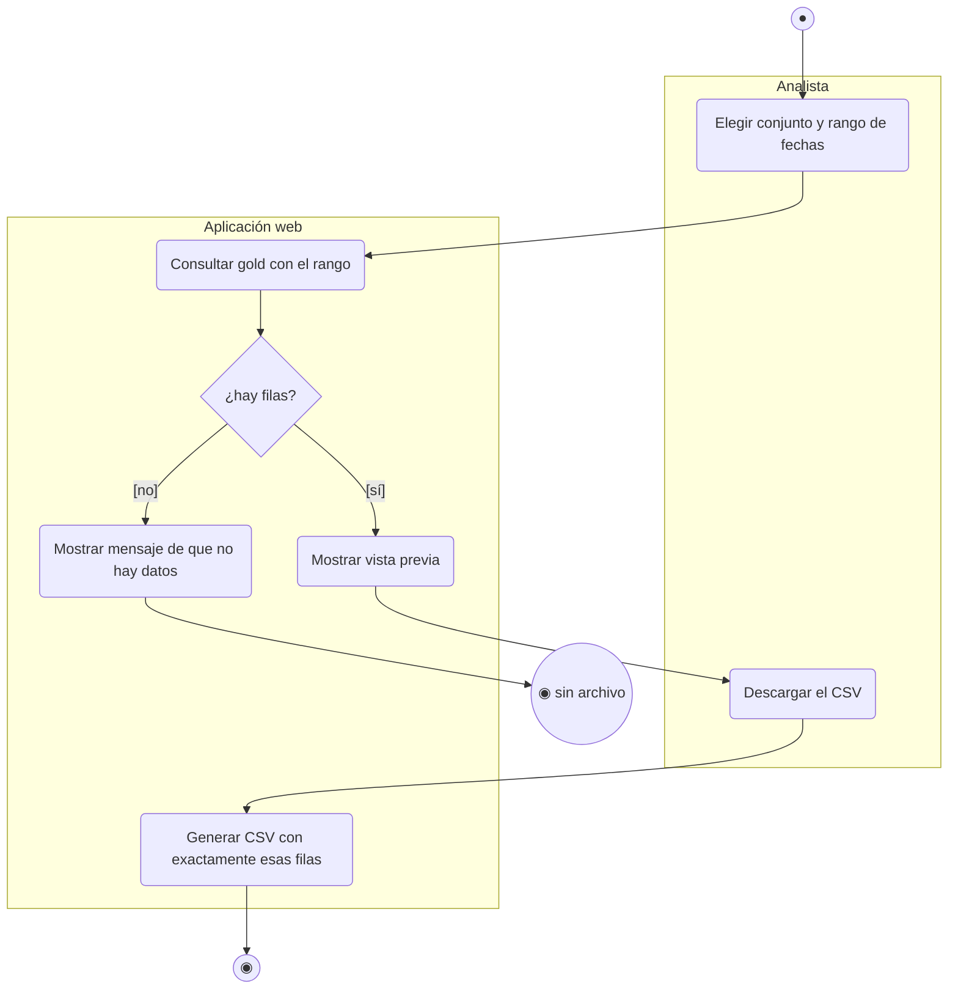
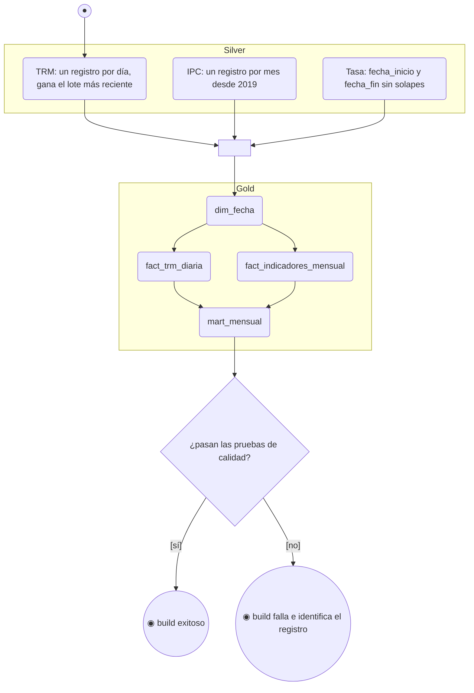

# Diagramas de actividades (Entregable 2, tema 3.5)

> **Notación.** Mermaid no tiene diagrama de actividades nativo. Se usa `flowchart` con la convención UML:
> `●` nodo inicial, `◉` nodo final, rombo para decisión o fusión, rectángulo redondeado para acción y `subgraph`
> como calle (partición) por responsable. Las guardas van entre corchetes en las flechas.

## 1. Ejecutar el pipeline (CU-02, HU-12, RF-08)

Fuente en código: `pipeline.py` (`ETAPAS`). Si una etapa falla, las siguientes no se ejecutan.

## 2. Cargar una fuente a bronze (CU-03, HU-03 a HU-06, RF-01, RF-02)

Dos caminos de lectura según la fuente; ambos convergen en la escritura de un lote.

## 3. Consultar y descargar datos (CU-06, HU-14, RF-09)

## 4. Construir silver y gold (CU-04, HU-07 a HU-10)

Las flechas desde silver hacia `F1` y desde `G1` hacia `G2` y `G3` representan sincronización (barra de
bifurcación y unión) en la notación UML: las tres tablas de silver deben estar listas antes de gold, y los dos
hechos se construyen en paralelo antes del mart.

## Trazabilidad

| Diagrama | CU | HU | RF/RNF | Prueba |
|---|---|---|---|---|
| 1. Ejecutar el pipeline | CU-02 | HU-12 | RF-08, RNF-02 | CP-E2E-01 |
| 2. Cargar una fuente | CU-03 | HU-03 a HU-06 | RF-01, RF-02 | CP-ING-01, 02, 03 |
| 3. Consultar y descargar | CU-06 | HU-14 | RF-09 | CP-APP-01 |
| 4. Construir silver y gold | CU-04 | HU-07 a HU-10 | RF-01b, RF-03 a RF-05 | CP-SIL-01, 02, CP-GLD-01, 02 |
