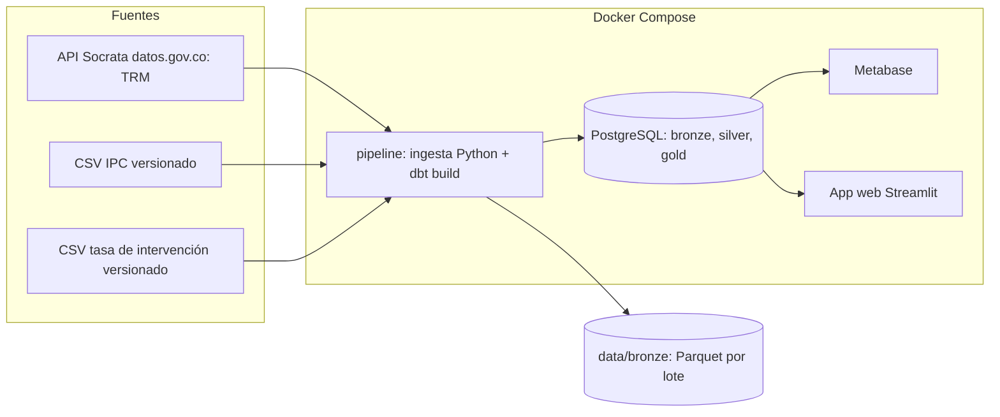
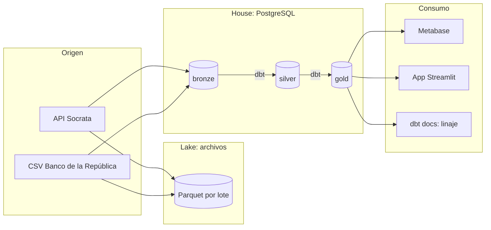
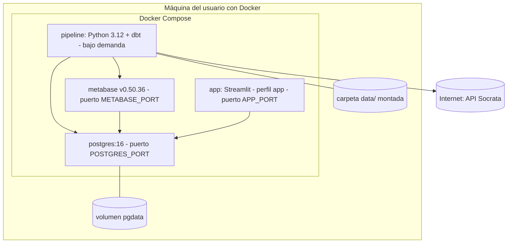

# Arquitectura y componentes (T-03)

Lakehouse híbrido: bronze se escribe como Parquet inmutable por lote (el lake, fuente de verdad) y se replica en PostgreSQL, donde dbt construye silver y gold (el house).

| Componente | Tecnología | Servicio Compose | Responsabilidad |
|---|---|---|---|
| Ingesta | Python (`ingesta/`) | `pipeline` | Extraer TRM, cargar CSV, escribir Parquet y `bronze.*_raw` |
| Transformación | dbt Core (`dbt/`) | `pipeline` | Construir silver y gold, ejecutar pruebas |
| Almacenamiento | PostgreSQL 16 | `postgres` | Esquemas `bronze`, `silver`, `gold` |
| Lake | Parquet en `data/bronze/` | volumen `./data` | Datos crudos inmutables por lote |
| Tablero | Metabase | `metabase` | HU-13, creado por script contra su API |
| Consulta y descarga | Streamlit (`app/`) | `app` (perfil `app`) | HU-14, lee gold |

Puertos y credenciales salen de `.env` (copia de `.env.example`).

## Vistas adicionales (Entregable 2, tema 3.6)

### Arquitectura por capas de datos

### Despliegue (nodos y artefactos)

## Justificación de las decisiones

| Decisión | Alternativas descartadas | Por qué | Requisito |
|---|---|---|---|
| Lakehouse híbrido: bronze en Parquet y PostgreSQL; silver y gold en PostgreSQL | Solo data warehouse; lake completo con motor de consulta | Conserva el dato crudo inmutable como fuente de verdad y deja SQL simple para dbt y las herramientas de BI, sin operar un motor adicional | RF-02, RF-03 |
| dbt Core para silver y gold | Scripts SQL sueltos; pandas | Pruebas de calidad, linaje y documentación vienen incluidos y las transformaciones quedan versionadas | RF-05, RF-06, RNF-05 |
| Periodicidad mixta con hechos separados (ADR-01, Opción B) | Una sola tabla diaria con rellenos | Cada hecho conserva su granularidad real; el mart mensual resuelve el cruce | RF-01b |
| Docker Compose como único requisito | Instalación local de cada herramienta | Reproducible en la máquina del evaluador con dos comandos | RNF-01, R-02 |
| Metabase creado por script contra su API | Tablero armado a mano | Sin pasos manuales y repetible tras cada instalación | RF-07 |
| Streamlit para la aplicación web | Otro framework web | Poco código para una consulta con descarga CSV | RF-09 |
| Un contenedor `pipeline` con un comando | Orquestador (Airflow) | Tres fuentes y un solo flujo no justifican operar un orquestador; el comando único cumple RF-08 | RF-08 |

### Atributos de calidad

| Atributo | Cómo lo cubre la arquitectura | Verificación |
|---|---|---|
| Reproducibilidad | Todo en Compose; imágenes con versión fija | CP-INST-01 |
| Rendimiento | Pipeline medido en 12 a 18 s frente al umbral de 5 min | CP-E2E-01 |
| Mantenibilidad | Separación ingesta, transformación, consumo; ruff y pytest en `verificar.py` | `verificar.py` |
| Trazabilidad del dato | Metadatos de lote en bronze y linaje con dbt docs | CP-ING-03, HU-11 |
| Seguridad básica | Sin secretos en el repositorio; la app publica su puerto solo en `127.0.0.1` | `.env.example` |

### Riesgos y limitaciones

- La TRM depende de una API externa; los reintentos mitigan fallas pasajeras, no una caída prolongada.
- IPC y tasa se descargan a mano; su automatización queda como trabajo futuro.
- No hay integración continua (R-01); la verificación es local con `verificar.py`.
