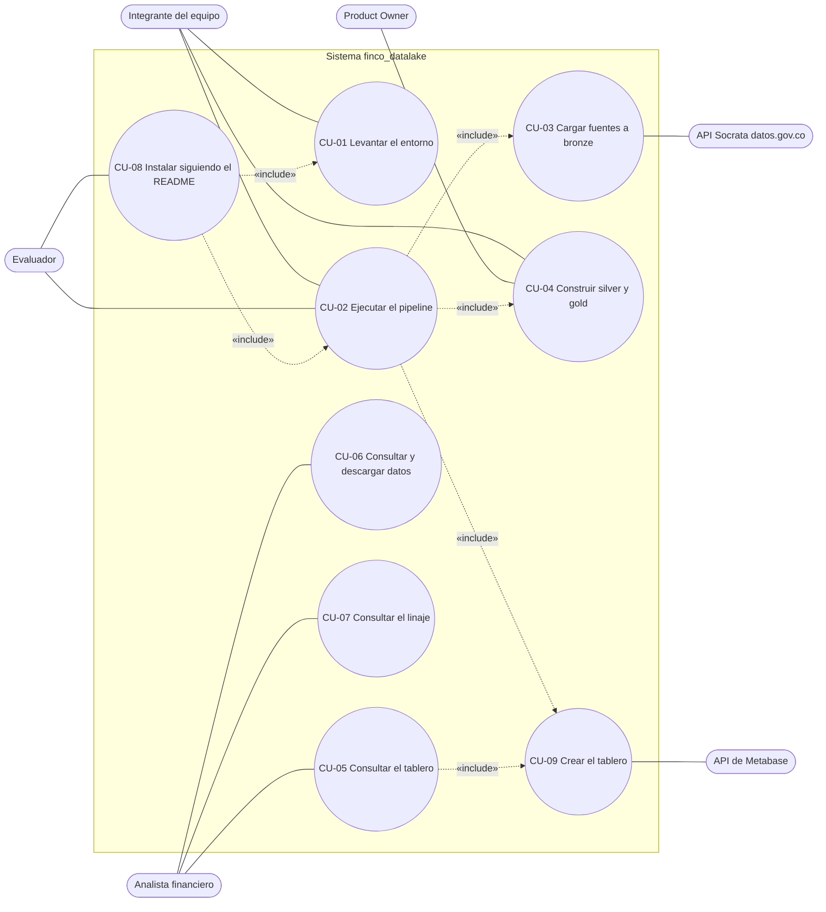

# Casos de uso (Entregable 2, tema 3.5)

Fuente: `entregables/entregable-1/06-product-backlog.md` (actores y HU) y `entregables/entregable-1/05-requisitos.md` (RF/RNF).

> **Notación.** Mermaid no tiene un tipo nativo de diagrama de casos de uso. Se usa `flowchart` con la convención UML:
> actores primarios a la izquierda, actores secundarios (sistemas externos) a la derecha, el límite del sistema como
> `subgraph`, casos de uso como óvalos y relaciones `«include»` / `«extend»` como flechas punteadas con estereotipo.

## 1. Diagrama de casos de uso

El caso CU-09 se separa de CU-02 porque el pipeline lo ejecuta como última etapa y porque otro actor secundario
(la API de Metabase) participa solo ahí.

## 2. Resumen

| ID | Caso de uso | Actor primario | Actor secundario | HU | RF/RNF |
|---|---|---|---|---|---|
| CU-01 | Levantar el entorno con `docker compose up -d` | Integrante | — | HU-01 | RNF-01 |
| CU-02 | Ejecutar el pipeline con `docker compose run --rm pipeline` | Evaluador, integrante | — | HU-12 | RF-08, RNF-02 |
| CU-03 | Cargar TRM, IPC y tasa a bronze (Parquet + PostgreSQL) | Pipeline (invocado por CU-02) | API Socrata | HU-03 a HU-06 | RF-01, RF-02 |
| CU-04 | Construir silver y gold con `dbt build` | Integrante, PO (acepta) | — | HU-07 a HU-10 | RF-01b, RF-03 a RF-05 |
| CU-05 | Consultar el tablero macroeconómico | Analista | — | HU-13 | RF-07 |
| CU-06 | Consultar y descargar datos de gold en la aplicación web | Analista | — | HU-14 | RF-09 |
| CU-07 | Consultar el linaje de cada campo | Analista | — | HU-11 | RF-06, RNF-05 |
| CU-08 | Instalar y ejecutar siguiendo solo el README | Evaluador | — | HU-02 | RNF-01, RF-08 |
| CU-09 | Crear el tablero con un script contra la API de Metabase | Pipeline (invocado por CU-02) | API de Metabase | HU-13 | RF-07 |

## 3. Plantilla de descripción

Cada caso usa los mismos campos: actores, objetivo, precondiciones, disparador, flujo principal, flujos alternos,
postcondiciones, reglas de negocio y trazabilidad.

### CU-01 Levantar el entorno

| Campo | Contenido |
|---|---|
| Actores | Integrante del equipo |
| Objetivo | Tener PostgreSQL con los esquemas `bronze`, `silver` y `gold` y Metabase en ejecución |
| Precondiciones | Docker con Compose instalado; `.env` copiado de `.env.example` |
| Disparador | El integrante ejecuta `docker compose up -d` |
| Flujo principal | 1) Compose crea el volumen y arranca `postgres`. 2) `db/init.sh` crea los esquemas. 3) Se espera a que `postgres` esté sano. 4) Arranca `metabase`. 5) Metabase queda sano (`/api/health`). |
| Flujos alternos | **A1.** Puerto ocupado: Compose falla y el integrante cambia el puerto en `.env`. **A2.** Falta `.env`: Compose falla por variables vacías. |
| Postcondiciones | `postgres` y `metabase` sanos; esquemas creados |
| Reglas | Sin secretos reales en el repositorio |
| Trazabilidad | HU-01, RNF-01, CP-INST-01 |

### CU-02 Ejecutar el pipeline

| Campo | Contenido |
|---|---|
| Actores | Evaluador, integrante |
| Objetivo | Cargar y transformar todo en un solo comando |
| Precondiciones | Entorno levantado (CU-01) |
| Disparador | `docker compose run --rm pipeline` |
| Flujo principal | 1) Ingesta de TRM (incluye CU-03). 2) Ingesta de IPC. 3) Ingesta de tasa. 4) `dbt build` (CU-04). 5) Creación del tablero (CU-09). 6) Informa la duración total y termina con código 0. |
| Flujos alternos | **A1.** Una etapa termina con código distinto de 0: el pipeline no ejecuta las etapas siguientes, informa cuál falló y termina con código distinto de 0. |
| Postcondiciones | Datos cargados en bronze, silver y gold; tablero creado |
| Reglas | RNF-02: menos de 5 minutos |
| Trazabilidad | HU-12, RF-08, RNF-02, CP-E2E-01 |

### CU-03 Cargar fuentes a bronze

| Campo | Contenido |
|---|---|
| Actores | Pipeline; secundario: API Socrata (solo TRM) |
| Objetivo | Conservar el dato original, sin transformar, con metadatos de lote |
| Precondiciones | PostgreSQL sano; para IPC y tasa, CSV en `data/fuentes/` |
| Disparador | Etapa de ingesta de CU-02 |
| Flujo principal | 1) Se lee la fuente: TRM paginada desde la API; IPC y tasa desde CSV. 2) Se genera un `lote_id` y `cargado_en`. 3) Se escribe un Parquet inmutable por lote. 4) Se insertan las filas en `bronze.*_raw` con fuente, fecha-hora y lote. |
| Flujos alternos | **A1 (TRM).** La API falla: se reintenta al menos 3 veces con espera creciente; si todos fallan, se registra el error y el código de salida es distinto de 0. **A2 (CSV).** El archivo no existe o no tiene filas: termina con código 1 y no crea lote. |
| Postcondiciones | Un lote nuevo por ejecución; los lotes anteriores no se modifican |
| Reglas | Inmutabilidad de bronze; la fila del CSV se guarda completa como `jsonb` |
| Trazabilidad | HU-03, 04, 05, 06; RF-01, RF-02; CP-ING-01, 02, 03 |

### CU-04 Construir silver y gold

| Campo | Contenido |
|---|---|
| Actores | Integrante; el PO acepta el resultado |
| Objetivo | Producir tablas limpias y el modelo estrella con calidad verificada |
| Precondiciones | Bronze con al menos un lote por fuente |
| Disparador | Etapa `dbt build` de CU-02 |
| Flujo principal | 1) Silver: TRM única por día (gana el lote más reciente); IPC por mes desde 2019; tasa con `fecha_inicio` y `fecha_fin` sin solapes. 2) Gold: `dim_fecha`, `fact_trm_diaria`, `fact_indicadores_mensual` y `mart_mensual`. 3) Se ejecutan las pruebas de calidad. |
| Flujos alternos | **A1.** Una prueba falla (unicidad, no nulidad, `relationships`): el build falla e identifica el registro. |
| Postcondiciones | `silver.*` y `gold.*` actualizados |
| Reglas | Opción B de periodicidad (ADR-01); el mart arranca en 2020-01 |
| Trazabilidad | HU-07 a HU-10; RF-01b, RF-03, RF-04, RF-05; CP-SIL-01, 02, CP-GLD-01, 02 |

### CU-05 Consultar el tablero

| Campo | Contenido |
|---|---|
| Actores | Analista financiero |
| Objetivo | Ver la evolución de TRM, inflación y tasa |
| Precondiciones | Pipeline ejecutado (el tablero ya existe con datos) |
| Disparador | El analista abre Metabase en su puerto |
| Flujo principal | 1) Abre el tablero «Tablero macroeconómico». 2) Ve al menos 3 visualizaciones: TRM, inflación anual y tasa frente a inflación. 3) Filtra por rango de fechas. |
| Flujos alternos | **A1.** Rango sin datos: las visualizaciones quedan vacías. |
| Postcondiciones | Ninguna (consulta) |
| Trazabilidad | HU-13, RF-07, CP-DASH-01 |

### CU-06 Consultar y descargar datos

| Campo | Contenido |
|---|---|
| Actores | Analista financiero |
| Objetivo | Obtener un CSV con las filas de gold de un rango de fechas |
| Precondiciones | Pipeline ejecutado; servicio `app` levantado |
| Disparador | El analista abre la aplicación web |
| Flujo principal | 1) Elige el conjunto (TRM diaria o mart mensual). 2) Elige el rango. 3) Ve la vista previa. 4) Descarga un CSV con exactamente esas filas. |
| Flujos alternos | **A1.** Rango sin datos: la aplicación muestra un mensaje y no ofrece archivo vacío. |
| Postcondiciones | Ninguna (lectura de gold) |
| Trazabilidad | HU-14, RF-09, CP-APP-01 |

### CU-07 Consultar el linaje

| Campo | Contenido |
|---|---|
| Actores | Analista financiero |
| Objetivo | Saber de qué fuente y transformación sale cada campo |
| Precondiciones | Modelos dbt con descripciones |
| Disparador | `dbt docs generate` y `dbt docs serve` |
| Flujo principal | 1) Abre la documentación. 2) Ve el grafo desde bronze hasta el mart. 3) Abre una columna del mart y lee su origen. |
| Flujos alternos | **A1.** Una columna sin descripción: es un defecto de documentación. |
| Postcondiciones | Ninguna |
| Trazabilidad | HU-11, RF-06, RNF-05 |

### CU-08 Instalar siguiendo el README

| Campo | Contenido |
|---|---|
| Actores | Evaluador |
| Objetivo | Tener el sistema funcionando en una máquina con solo Docker |
| Precondiciones | Docker con Compose; conexión a internet |
| Disparador | El evaluador sigue «Inicio rápido» |
| Flujo principal | 1) Clona el repositorio. 2) Copia `.env.example` a `.env`. 3) CU-01. 4) CU-02. 5) Abre el tablero y la aplicación web. |
| Flujos alternos | **A1.** Sin internet: la ingesta de TRM falla (flujo A1 de CU-03). |
| Postcondiciones | Sistema operativo con datos cargados |
| Trazabilidad | HU-02, RNF-01, RF-08, CP-INST-01 |

### CU-09 Crear el tablero

| Campo | Contenido |
|---|---|
| Actores | Pipeline; secundario: API de Metabase |
| Objetivo | Tener el tablero creado sin pasos manuales |
| Precondiciones | Gold cargado; Metabase sano; credenciales en `.env` |
| Disparador | Última etapa de CU-02 |
| Flujo principal | 1) Inicia sesión en la API. 2) Si el tablero no existe, registra la base de datos (si falta) y espera a que Metabase sincronice `gold.mart_mensual`. 3) Crea las tarjetas y el tablero con filtro `Fechas`. |
| Flujos alternos | **A1.** El tablero ya existe: no crea otro. **A2.** Metabase no responde o no sincroniza gold: informa el error y termina con código 1. |
| Postcondiciones | Tablero «Tablero macroeconómico» creado |
| Trazabilidad | HU-13, RF-07, CP-DASH-01 |
