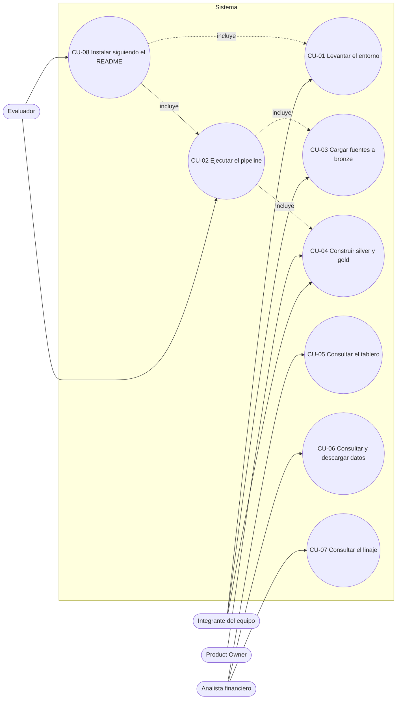
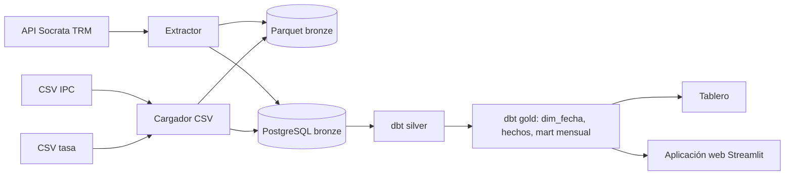
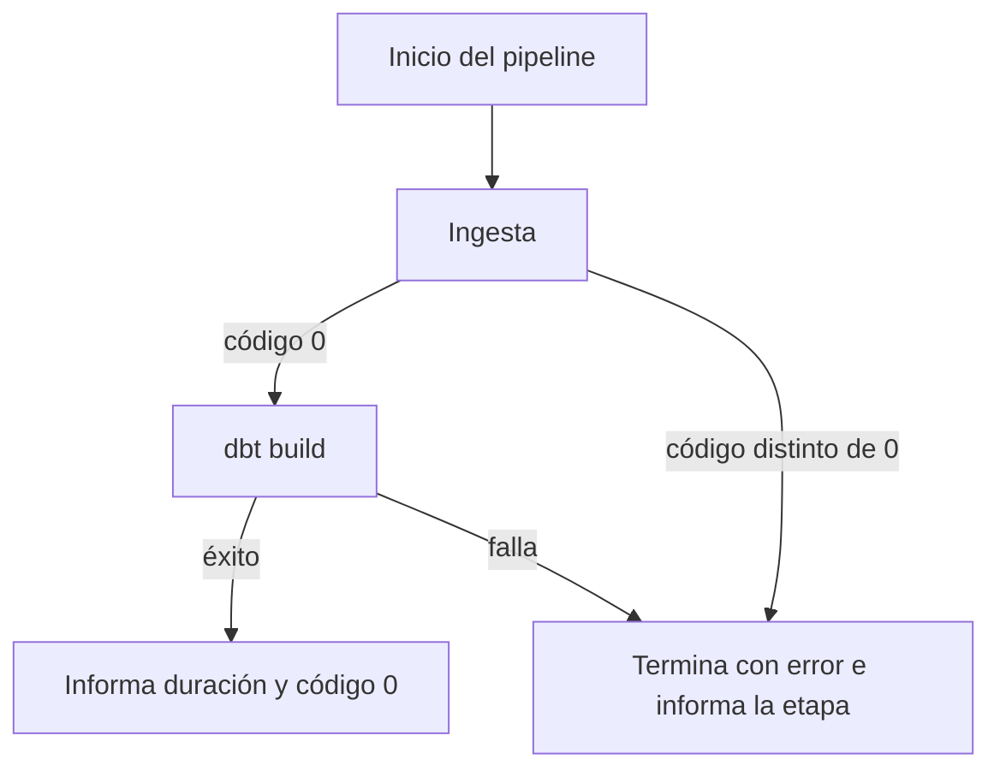

# Casos de uso y flujos (T-02)

Fuente: `entregables/entregable-1/06-product-backlog.md` (actores y HU) y `entregables/entregable-1/05-requisitos.md` (RF/RNF).

## 1. Diagrama de casos de uso

## 2. Casos de uso

| ID | Caso de uso | Actor | HU | RF/RNF |
|---|---|---|---|---|
| CU-01 | Levantar el entorno con `docker compose up -d` | Integrante | HU-01 | RNF-01 |
| CU-02 | Ejecutar el pipeline con `docker compose run --rm pipeline` | Evaluador, integrante | HU-12 | RF-08, RNF-02 |
| CU-03 | Cargar TRM, IPC y tasa a bronze (Parquet + PostgreSQL) | Integrante | HU-03 a HU-06 | RF-01, RF-02 |
| CU-04 | Construir silver y gold con `dbt build` | Integrante, PO (acepta) | HU-07 a HU-10 | RF-03 a RF-05, RF-01b |
| CU-05 | Consultar el tablero macroeconómico | Analista | HU-13 | RF-07 |
| CU-06 | Consultar y descargar datos de gold en la aplicación web | Analista | HU-14 | RF-09 |
| CU-07 | Consultar el linaje de cada campo | Analista | HU-11 | RF-06, RNF-05 |
| CU-08 | Instalar y ejecutar siguiendo solo el README | Evaluador | HU-02 | RNF-01, RF-08 |

## 3. Especificación breve

### CU-02 Ejecutar el pipeline
- **Precondición:** entorno levantado (CU-01) y `.env` copiado.
- **Flujo principal:** 1) ingesta de TRM, IPC y tasa; 2) `dbt build`; 3) el script informa la duración total y termina con código 0.
- **Flujo alterno:** un extractor termina con código distinto de 0, el pipeline no ejecuta `dbt build` y termina con código distinto de 0 indicando la etapa fallida.

### CU-03 Cargar fuentes a bronze
- **Flujo principal:** el cargador lee la fuente (API Socrata para la TRM; CSV versionado en `data/fuentes/` para IPC y tasa), escribe un Parquet inmutable por lote y replica las filas en `bronze`, con fuente, fecha-hora de carga e identificador de lote.
- **Flujo alterno (TRM):** la fuente falla, se reintenta al menos 3 veces con espera creciente; si todos fallan, se registra el error y el código de salida es distinto de 0.
- **Flujo alterno (CSV):** el archivo no existe o no tiene filas, termina con código 1 y no crea lote.
- **Regla:** una nueva ejecución crea un lote nuevo y no modifica los anteriores.

### CU-04 Construir silver y gold
- **Silver:** TRM única por día (gana el lote más reciente); IPC por mes; tasa con `fecha_inicio` y `fecha_fin` sin solapes.
- **Gold:** `dim_fecha`, hecho diario de TRM, hecho mensual de indicadores y mart mensual (TRM promedio, IPC y tasa vigente).
- **Calidad:** `unique`, `not_null`, `relationships` y rangos válidos; si un test falla, el build falla.

### CU-05 Consultar el tablero
- **Flujo principal:** el analista abre el tablero con datos cargados, ve al menos 3 visualizaciones (TRM, inflación anual, tasa frente a inflación) y filtra por rango de fechas.

### CU-06 Consultar y descargar datos
- **Flujo principal:** elige conjunto y rango, ve la vista previa y descarga un CSV con exactamente esas filas.
- **Flujo alterno:** rango sin datos, muestra un mensaje y no genera archivo.

### CU-07 Consultar el linaje
- **Flujo principal:** `dbt docs generate` y `dbt docs serve`; el grafo muestra el camino de bronze al mart y cada columna del mart indica su origen.

## 4. Flujo de datos de punta a punta

## 5. Flujo de falla en la ingesta

