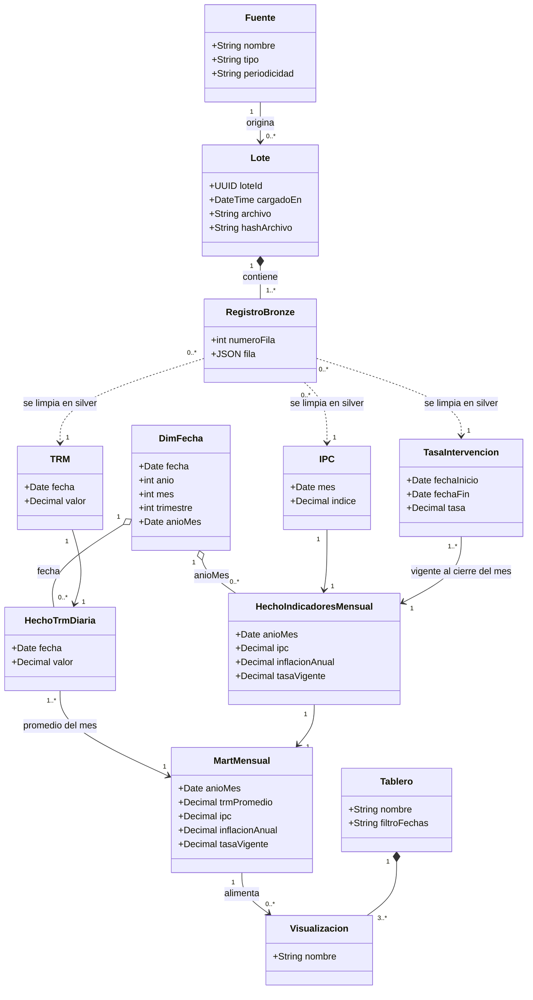
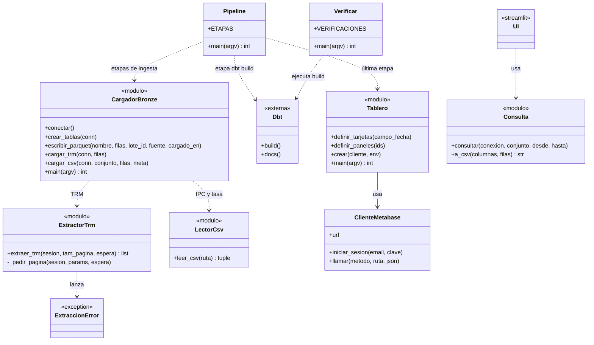

# Diagramas de clases (Entregable 2, tema 3.6)

Dos vistas: el modelo de dominio (qué existe en el negocio) y las clases de diseño (qué componentes lo
implementan). Los nombres de operaciones de la segunda vista son las funciones reales del código.

## 1. Modelo de dominio

### Reglas del modelo

| Regla | Fuente |
|---|---|
| Un lote pertenece a una sola fuente y no se modifica | RF-02 |
| Cada fila de bronze conserva la fila original completa | RF-02 |
| Las vigencias de `TasaIntervencion` no se solapan | RF-01b, HU-08 |
| El mart tiene una fila por mes, desde 2020-01 | RF-01b, HU-09 |
| Un tablero tiene al menos 3 visualizaciones | RF-07 |

## 2. Clases de diseño

### Responsabilidades

| Clase o módulo | Responsabilidad | Requisito |
|---|---|---|
| `Pipeline` | Ejecutar etapas en orden y detenerse en la primera que falle | RF-08 |
| `ExtractorTrm` | Paginar la API y reintentar al menos 3 veces | RF-01 |
| `LectorCsv` | Leer el CSV y calcular su hash | RF-01, RF-02 |
| `CargadorBronze` | Escribir Parquet y filas con metadatos de lote | RF-02 |
| `Tablero` y `ClienteMetabase` | Crear el tablero por la API sin pasos manuales | RF-07 |
| `Consulta` y `Ui` | Consultar gold y generar el CSV | RF-09 |
| `Verificar` | Ejecutar ruff, pytest y `dbt build` | RNF-03 |

## Trazabilidad

| Vista | CU | HU | RF/RNF |
|---|---|---|---|
| Dominio | CU-03 a CU-07 | HU-03 a HU-11 | RF-01 a RF-07 |
| Diseño | CU-02, CU-03, CU-06, CU-09 | HU-03 a HU-06, HU-12 a HU-14 | RF-01, RF-02, RF-07 a RF-09 |
