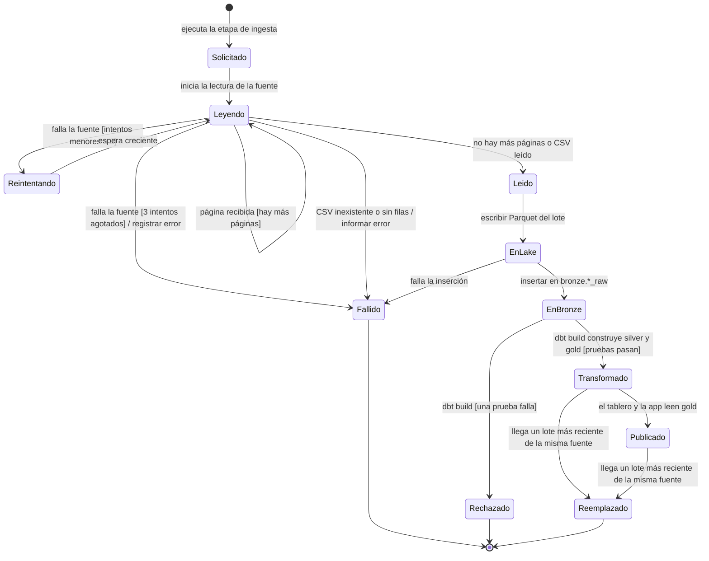

# Diagrama de estados (Entregable 2, tema 3.5)

## Entidad crítica: el lote de ingesta

El **lote** es la entidad crítica del sistema: cada ejecución de ingesta crea uno nuevo, nunca modifica los
anteriores (bronze es inmutable) y de él dependen silver, gold, el tablero y la aplicación web. Un lote
identifica sus filas por `lote_id` en `bronze.*_raw` y en `data/bronze/<conjunto>/lote_id=<id>/datos.parquet`.

### Descripción de los estados

| Estado | Significado | Qué hay en disco o en la base |
|---|---|---|
| Solicitado | El pipeline invocó la etapa de ingesta | Nada |
| Leyendo | Se leen las páginas de la API o el CSV | Datos en memoria |
| Reintentando | La API falló y se espera antes de otro intento | Datos parciales en memoria |
| Leido | Fuente leída por completo | Datos en memoria |
| EnLake | Parquet del lote escrito | `data/bronze/.../lote_id=<id>/datos.parquet` |
| EnBronze | Filas insertadas con fuente, fecha-hora y lote | `bronze.*_raw` |
| Transformado | silver y gold se construyeron a partir del lote y pasaron las pruebas | `silver.*`, `gold.*` |
| Publicado | Los consumidores leen sus datos | El tablero y la aplicación web |
| Fallido | La ingesta terminó con error y código distinto de 0 | Sin lote nuevo en bronze (ver nota) |
| Rechazado | Una prueba de calidad de dbt falló | El lote queda en bronze, sin publicarse |
| Reemplazado | Un lote más reciente de la misma fuente gana en silver | El lote se conserva en bronze |

**Nota sobre el fallo en `EnLake`.** El Parquet se escribe antes de la inserción en PostgreSQL. Si la inserción
falla, el archivo del lote queda en el lake sin su réplica en bronze; el siguiente lote usa otro `lote_id`.
Es una limitación conocida del diseño actual.

### Reglas del diseño

- Un lote nunca vuelve a un estado anterior: la reejecución crea otro lote.
- `Reemplazado` no borra datos: silver elige el lote más reciente por clave de negocio y bronze conserva todo.
- Los estados `Fallido`, `Rechazado` y `Reemplazado` son finales.

## Trazabilidad

| Elemento | Referencia |
|---|---|
| Casos de uso | CU-03, CU-04, CU-05, CU-06 |
| HU | HU-03 a HU-08, HU-12 |
| Requisitos | RF-01, RF-02, RF-03, RF-05 |
| Pruebas | CP-ING-01, 02, 03; CP-SIL-01 |
