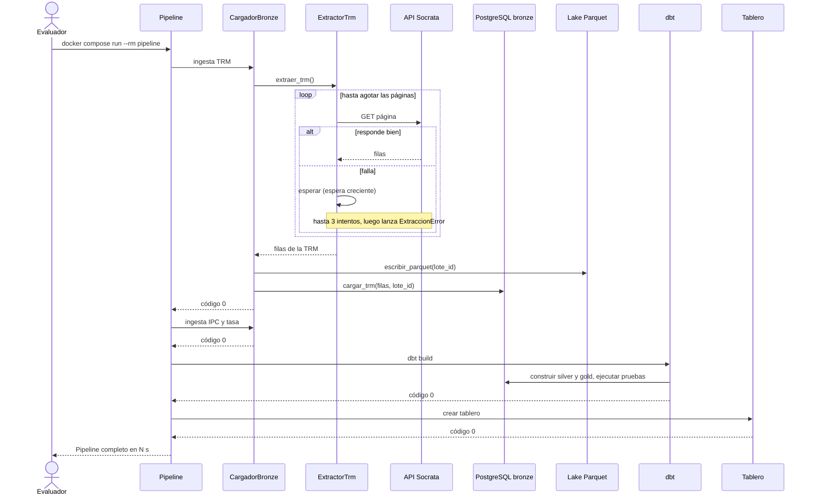
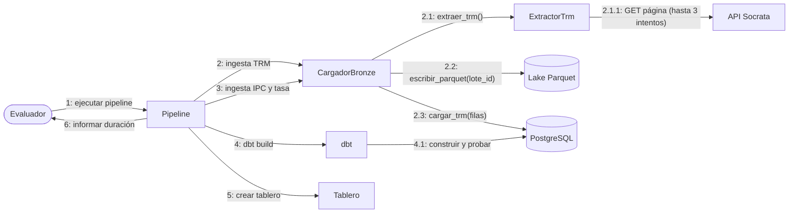
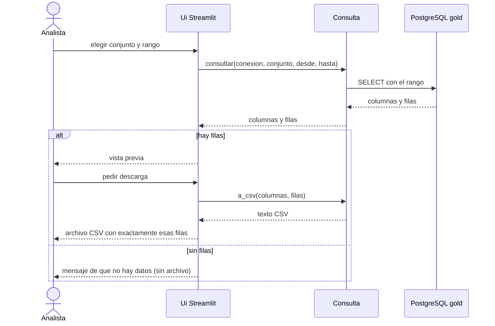
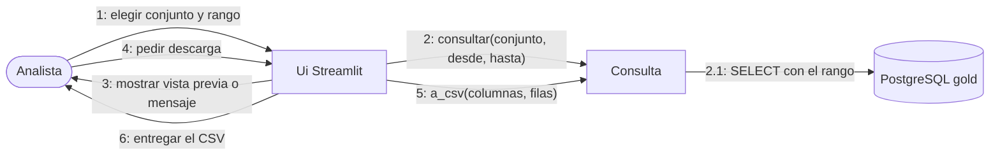
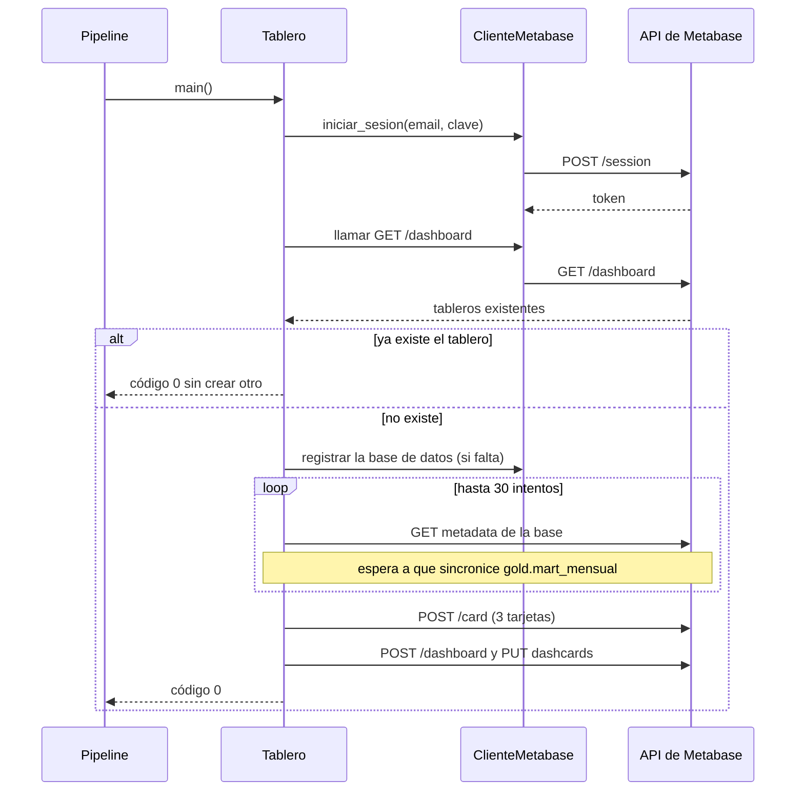
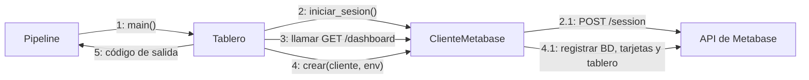

# Diagramas de interacción (Entregable 2, tema 3.7)

Para cada funcionalidad clave hay un diagrama de secuencia (orden temporal) y un diagrama de colaboración
(organización de los objetos y mensajes numerados). Los dos describen la misma interacción.

> **Notación.** Las secuencias usan `sequenceDiagram` de Mermaid, que es UML. Mermaid no tiene diagrama de
> comunicación (colaboración) nativo: se dibuja con `flowchart` donde los nodos son objetos, los enlaces son
> las asociaciones y cada mensaje lleva su número de secuencia (`1`, `1.1`, `2`…), como pide la notación UML.

## 1. Ejecutar el pipeline con ingesta de la TRM (CU-02, CU-03)

### Secuencia

### Colaboración

## 2. Consultar y descargar datos (CU-06)

### Secuencia

### Colaboración

## 3. Crear el tablero (CU-09)

### Secuencia

### Colaboración

## Trazabilidad

| Interacción | CU | HU | RF/RNF | Prueba |
|---|---|---|---|---|
| 1. Pipeline con ingesta de la TRM | CU-02, CU-03 | HU-03, HU-06, HU-12 | RF-01, RF-02, RF-08 | CP-ING-01, 02, CP-E2E-01 |
| 2. Consultar y descargar | CU-06 | HU-14 | RF-09 | CP-APP-01 |
| 3. Crear el tablero | CU-09 | HU-13 | RF-07 | CP-DASH-01 |
