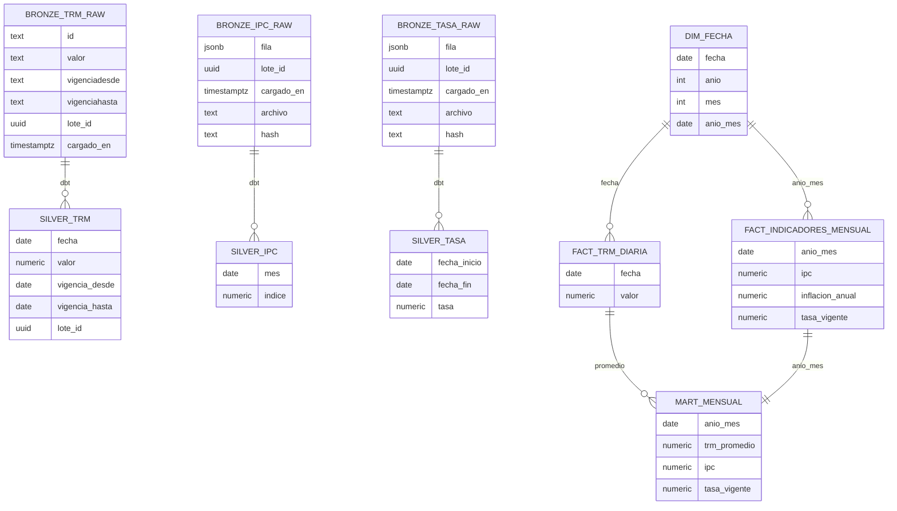

# Modelo de datos y ADR-01 (T-04)

## 1. Capas

Vigentes hoy: `bronze.*_raw`, `silver.trm`, `gold.dim_fecha`, `gold.fact_trm_diaria`. El resto es diseño para HU-08 y HU-09; los nombres de columnas se confirman al implementarlos.

## 2. ADR-01 Periodicidad mixta: Opción B (D-03)

- **Contexto:** la TRM es diaria, el IPC mensual y la tasa de intervención cambia por decisión (vigencia).
- **Decisión:** hechos separados por periodicidad; la tasa se modela con `fecha_inicio` y `fecha_fin` sin solapes; un mart mensual en gold une TRM promedio, IPC y tasa vigente.
- **Alternativas descartadas:** (A) un único hecho diario repitiendo IPC y tasa: duplica valores y confunde la granularidad; no se detalló otra en los documentos del repositorio.
- **Consecuencias:** más tablas, pero cada hecho conserva su granularidad real; la tasa vigente de un mes se resuelve por intersección de vigencia.
- **Estado:** confirmada por el equipo.
