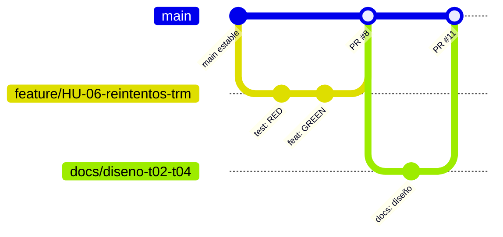
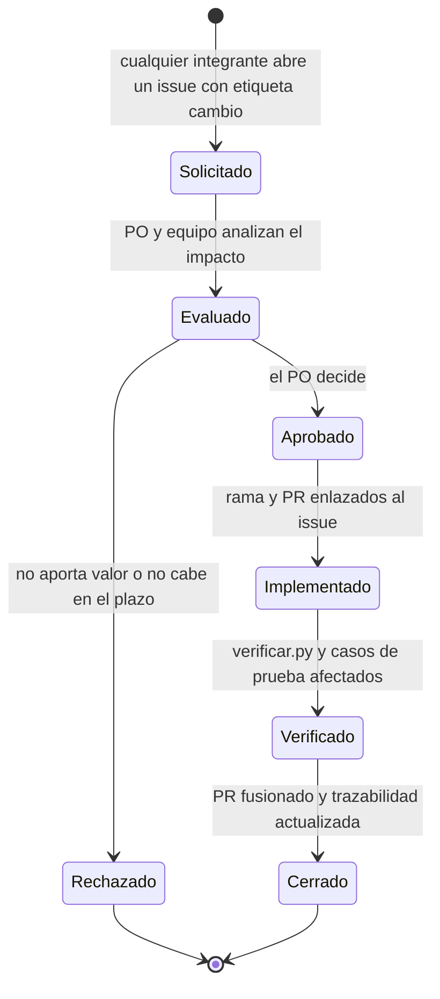

# Estrategia de versionado y control de cambios (Entregable 2, tema 2.7)

## 1. Modelo de ramas: GitHub Flow simplificado

El equipo usa **GitHub Flow** y no Gitflow. La decisión (D-08) se justifica así:

| Criterio | Gitflow (`develop`, `release`, `hotfix`) | GitHub Flow (elegido) |
|---|---|---|
| Equipo | Pensado para varios equipos y versiones en paralelo | 3 personas y una sola versión viva |
| Releases | Ramas de release y mantenimiento | Una entrega final (20 nov); `main` siempre es entregable |
| Costo de ceremonia | Alto: ramas de larga vida y fusiones dobles | Bajo: ramas cortas y un PR |
| Trazabilidad HU → código | Posible | Directa: una rama y un PR por HU |
| Riesgo con el plazo | Fusiones entre `develop` y `main` consumen horas | Mínimo |

Gitflow se reconsideraría si el proyecto mantuviera versiones publicadas en paralelo; no es el caso.

### Reglas

1. `main` siempre funciona. Todo cambio entra por Pull Request con la aprobación de otro integrante; no se hace push directo.
2. Cada historia tiene su rama corta desde `main`, de menos de una semana:
   - `feature/HU-03-extractor-trm`
   - `fix/HU-03-paginacion-trm`
   - `docs/casos-de-uso`
3. Antes de abrir el PR: `git pull origin main`, resolver conflictos y correr `python verificar.py`.
4. El PR enlaza la HU y pega la salida de `verificar.py`, porque no hay integración continua (R-01).
5. Tamaño de PR: hasta unas 400 líneas de cambio; si es mayor, se divide en PR apilados que se fusionan en orden.
6. Se fusiona con el PR hacia `main` y se borra la rama.

## 2. Convención de commits

Formato: `tipo(alcance): descripción breve (HU-xx)`

| Tipo | Uso | Ejemplo |
|---|---|---|
| `feat` | Funcionalidad nueva | `feat(ingesta): extractor TRM con paginación (HU-03)` |
| `fix` | Corrección | `fix(compose): healthcheck de Metabase (HU-02)` |
| `test` | Pruebas | `test(dbt): fijar que el mart empieza en 2020-01` |
| `docs` | Documentación | `docs: actas de sprint y retrospectiva` |
| `chore` | Configuración | `chore: ignorar la configuración local` |

Un commit es una unidad revisable: las pruebas y la documentación de un comportamiento van en el mismo commit que su código.

## 3. Qué se versiona

| Elemento | Versionado | Nota |
|---|---|---|
| Código de ingesta, pipeline, tablero y app | Sí | `ingesta/`, `pipeline.py`, `metabase/`, `app/` |
| Transformaciones | Sí | `dbt/models/`, `dbt/tests/` |
| CSV de IPC y tasa | Sí | `data/fuentes/`, con hash en cada lote |
| Documentación | Sí | `docs/`, `entregables/` |
| Secretos | No | `.env` ignorado; solo `.env.example` |
| Datos generados | No | Parquet por lote, `dbt/target`, `dbt/logs` |

## 4. Versiones y entregas

- La numeración de entregas sigue los hitos del proyecto: Entregable 1 (planeación), Entregable 2 (diseño, revisión intermedia del 30 oct) y entrega final (20 nov).
- Cada hito se marcará con una etiqueta de Git (`entregable-1`, `entregable-2`, `entrega-final`) sobre un commit de `main`, para poder recuperar exactamente lo entregado.

## 5. Gestión y control de cambios

El control de cambios aplica a cambios de **requisitos, alcance o diseño**. Un cambio de código que no altera lo anterior sigue el flujo de PR normal.

### Pasos

1. **Solicitud.** Un issue describe qué cambia, por qué y qué requisito, HU o documento toca.
2. **Evaluación de impacto.** Se revisan la trazabilidad (`docs/gestion/trazabilidad.md`), el backlog, los diagramas y los casos de prueba afectados, y el efecto en el cronograma. Se estima el esfuerzo en puntos.
3. **Decisión.** El PO aprueba o rechaza. Los cambios que superan la capacidad del sprint se difieren al siguiente.
4. **Implementación.** Rama `feature/` o `fix/` con el número de la HU; el PR enlaza el issue con `Closes #n`.
5. **Verificación.** Se ejecuta `python verificar.py` y los casos de prueba afectados.
6. **Cierre.** Se actualizan la trazabilidad, los diagramas y el backlog en el mismo PR. El requisito modificado conserva su ID y registra la fecha del cambio.

### Registro de cambios

| Cambio | Fecha | Motivo | Aprobó | Impacto |
|---|---|---|---|---|
| Calendario comprimido a una semana por sprint | 25 oct | El sprint 1 cerró sin código | PO | Cronograma |
| Nueva HU-14 (aplicación web) | 25 oct | Petición del PO | PO | Backlog, RF-09 |
| Arquitectura lakehouse híbrido reemplaza a data warehouse | 27 oct | Decisión del PO | PO | Modelo de datos, arquitectura |
| Healthcheck de Metabase y espera en `pipeline` | 30 oct | Falla encontrada en la instalación limpia | Por confirmar (PR #23) | `docker-compose.yml`, HU-02 |

### Roles

| Rol | Responsabilidad |
|---|---|
| Product Owner | Aprobar o rechazar cambios de requisitos y alcance |
| Autor | Documentar el impacto y mantener la trazabilidad |
| Revisor (otro integrante) | Aprobar el PR; verificar que la documentación cambió con el código |

## Trazabilidad

| Elemento | Referencia |
|---|---|
| Requisito | RNF-04 (transformaciones versionadas) |
| Decisión | D-08 (README) |
| Prueba | Historial de Git con PR enlazados a HU |
